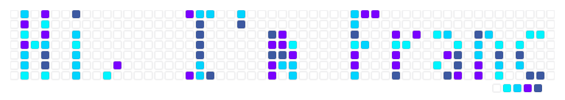
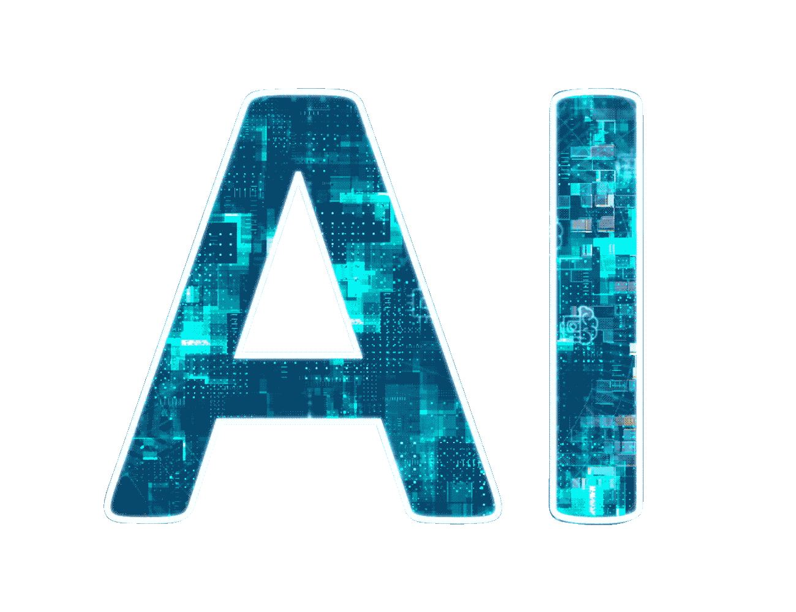
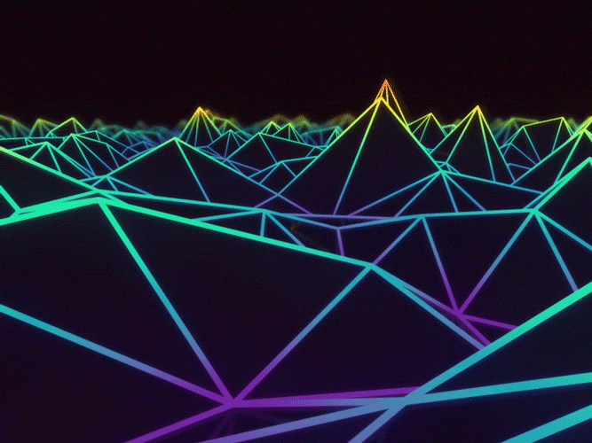
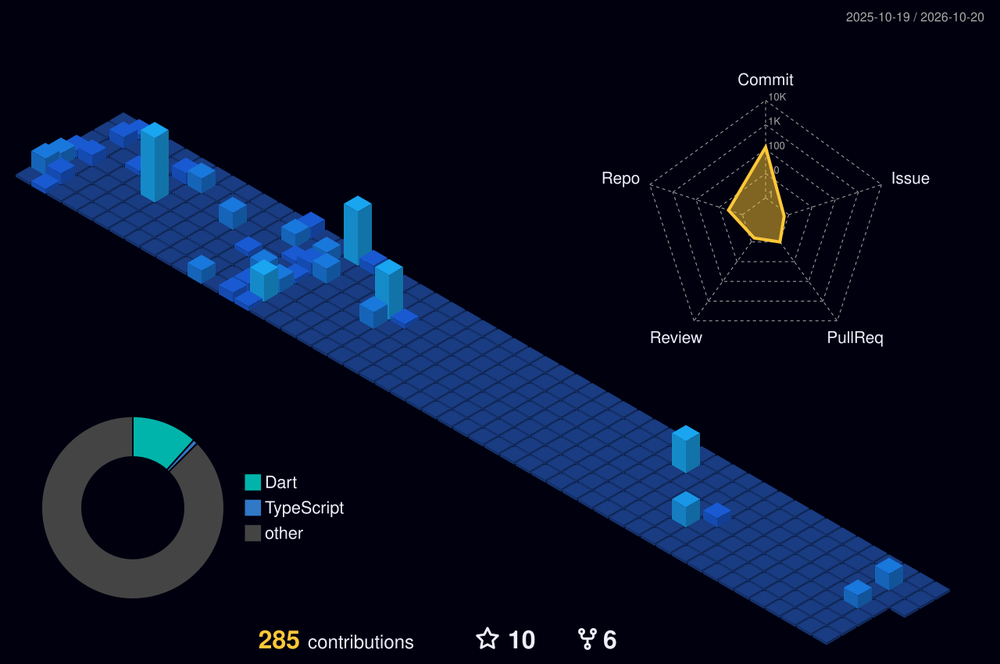
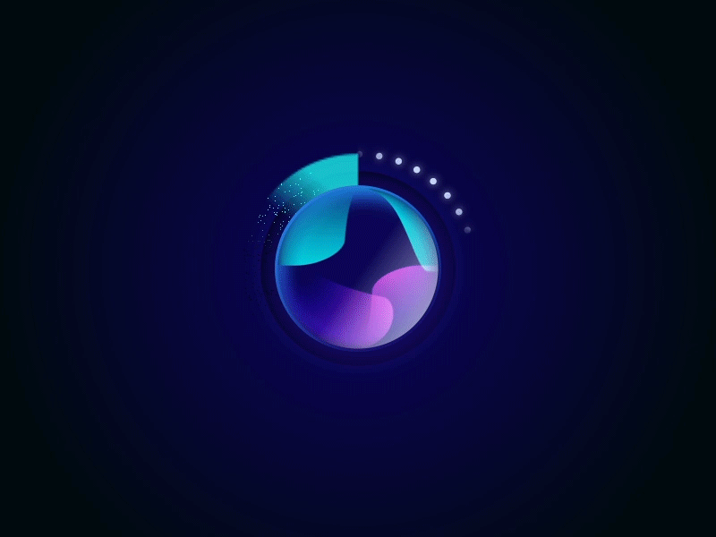
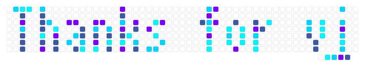

    

 

    

<h1> <picture></picture> About Me <picture></picture>
</h1>

  <em>
    Hello, I am Francesco Di Giore, an <b>M.Sc. graduate</b> in Computer Science and Engineering -- Artificial Intelligence from <a href="https://www.polimi.it/"> <b>Politecnico di Milano</b></a>. 
    I’m passionate about <b>Artificial Intelligence</b> , constantly exploring how machines can <b>learn, adapt, and enhance human creativity</b>.     
      My goal is to build <b>innovative AI systems</b> that make life smarter and more meaningful.
</em>

<picture> </picture>

    

        <ul style="list-style-type: none; padding: 0;">
            <li>✔ Call me: <b>He/Him</b> </li>
            <li>✔ Currently learning: <b>Generative AI, NLP, AI, Robotics, Deep Learning, Machine Learning</b> </li>
            <li>✔ BSc Degree: Ing Ind - Inf (1 liv.)(ord. 270) - MI (358) INGEGNERIA INFORMATICA at Politecnico di Milano</li>
            <li>✔ MSc Degree: Ing Ind - Inf (Mag.)(ord. 270) - MI (481) COMPUTER SCIENCE AND ENGINEERING - ARTIFICIAL INTELLIGENCE at Politecnico di Milano</li>
            <li>✔ Research interests: <b>AI for healthcare, LLMs & Vision-Language Models, LLM orchestration</b></li>
            <li>✔ How to reach me: <a href="mailto:digiorefrancesco10@gmail.com">digiorefrancesco10@gmail.com</a> or <a href="mailto:francesco.digiore@mail.polimi.it">francesco.digiore@mail.polimi.it</a></li>
            <li>✔ Hobbies: sports, video games, TV series, films, hanging out with friends</li>
            <li>✔ Contact me in private for my <b>CV</b> </li>
        </ul>
    

  
  
  
  

  <h1> <b>Skills</b> </h1>

   <!-- Languages -->
   <!-- Languages -->
   
  <h2>Languages</h2>
  

  

    
    
    
    
    
    
    
    
  

  <!-- Frameworks & Libraries -->
   
  <h2>Frameworks & Libraries</h2>
  

  

    
    
    
    
    
    
    
    
    
  

  <!-- Databases -->
   
  <h2>Databases</h2>
  

  

    
    
    
    
    
    
    
  

  <!-- Tools & Platforms -->
   
  <h2>Tools & Platforms</h2>
  

  

    
    
    
    
    
    
    
    
    
    
    
    
    
    
    
    
    
    
  

  

<!--horizontal divider(gradiant)-->

  <h1> <b>Repositories</b> </h1> 
    

        
         
        
        
        
        
         
         
        
        
    

  <h1> <b>Statistics</b> </h1> 
    

        
        
        
        
        
        
    

    <h1> <b>3D Contributions</b> </h1>

    

    <h1> <b>Snake</b> </h1>

   
  
  
   

        
        <h3>Updating...</h3>
 

  

 

  <b><i>"The best way to predict the future is to invent it." - Alan Kay</i></b>

    <h1><b>References</b></h1>

For more details about my references and tools, check out [REFERENCE.md](REFERENCE.md).

    

<!--
**Digioref/Digioref** is a ✨ _special_ ✨ repository because its `README.md` (this file) appears on your GitHub profile.

Here are some ideas to get you started:

- 🔭 I’m currently working on ...
- 🌱 I’m currently learning ...
- 👯 I’m looking to collaborate on ...
- 🤔 I’m looking for help with ...
- 💬 Ask me about ...
- 📫 How to reach me: ...
- 😄 Pronouns: ...
- ⚡ Fun fact: ...
-->
